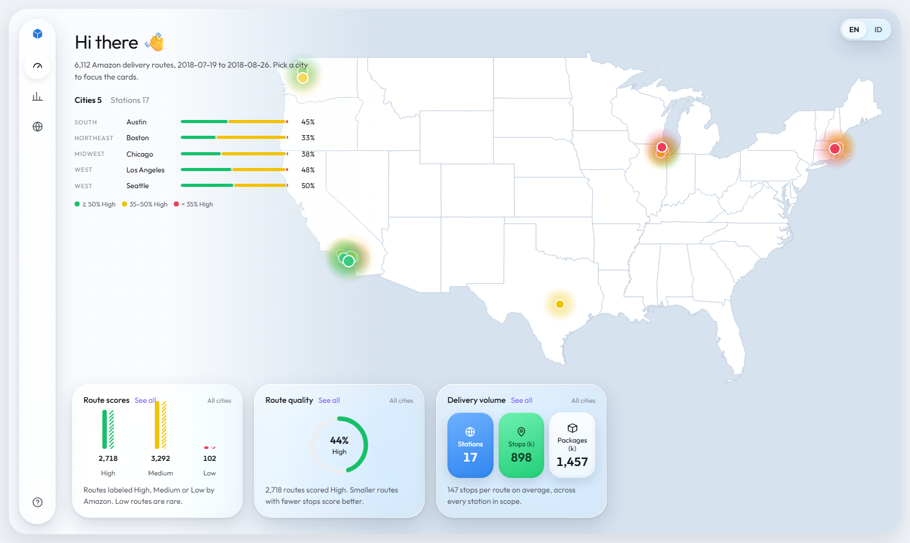
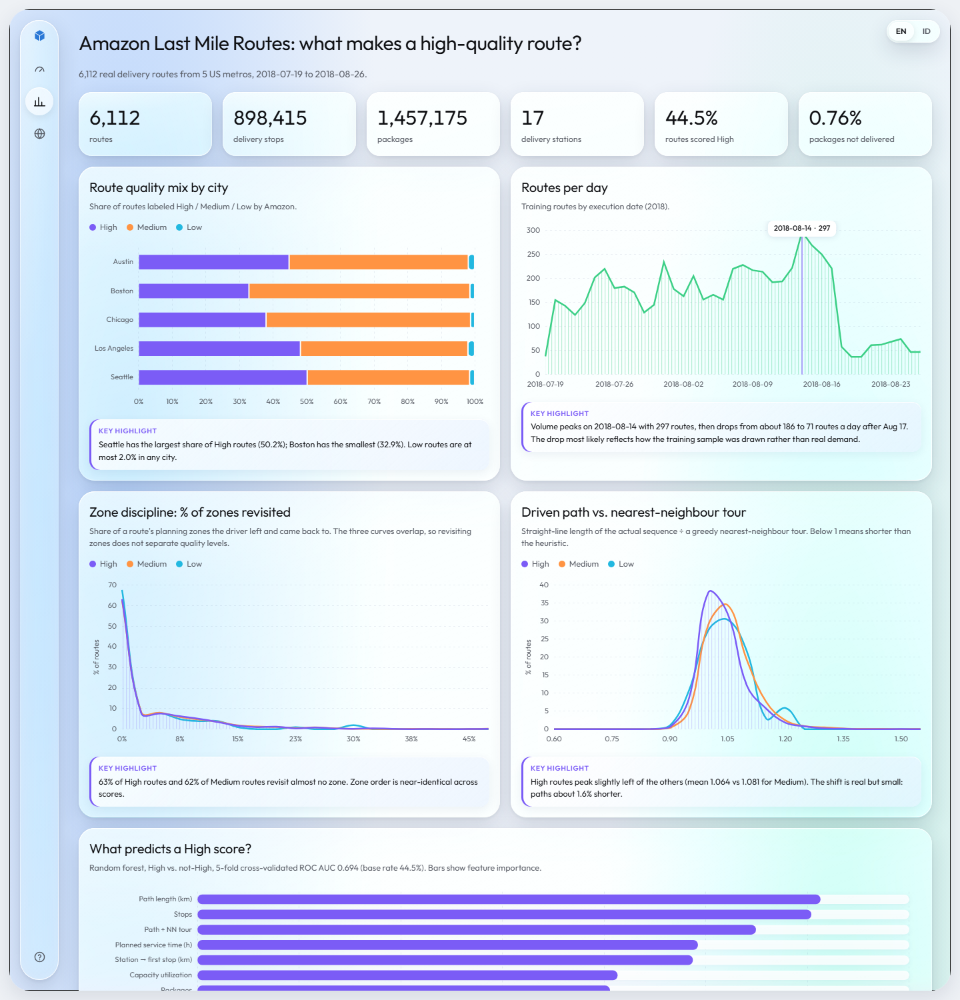

# What makes a high-quality delivery route?

An analysis of **6,112 real Amazon delivery routes** from the
[2021 Amazon Last Mile Routing Research Challenge](https://registry.opendata.aws/amazon-last-mile-challenges/)
(Merchán et al., *Transportation Science* 58(1), 2024). Each route was driven in 2018 in Seattle,
Los Angeles, Austin, Chicago or Boston. Amazon labeled each route **High, Medium, or Low** based on
how it was driven.

**Live dashboard:** https://fakhorfafa.github.io/amazon_last_mile_routes/

**Question:** Which features of the stop sequence a driver actually drove separate High-quality routes from the rest?



The dashboard has three views, in English and Indonesian, with a guided tour on first visit:

- **Overview:** stations on a US map coloured by share of High routes, a city list, and summary cards that follow the selected city.
- **Analysis:** every chart, each with a computed key highlight, and an analysis summary at the bottom.
- **Sample routes:** six Boston routes replayed stop by stop on a 3D map.



## Results

The analysis covers 6,112 routes, 898,415 stops and 1,457,175 packages across 17 stations (19 Jul to 26 Aug 2018).

| | High | Medium | Low |
|---|---|---|---|
| Routes | 2,718 | 3,292 | 102 |
| Avg stops | 139.6 | 153.0 | 150.3 |
| Avg straight-line path (km) | 60.0 | 67.6 | 65.5 |
| Packages with a time window | 8.2% | 8.0% | 2.7% |
| Driver drive time vs optimizer (median) | +11.7% | +11.5% | +11.3% |
| Time-window packages estimated late | 0.8% | 1.2% | 7.6% |
| % of zones revisited | 3.9% | 4.0% | 3.2% |

1. **Late deliveries separate Low routes.** 7.6% of time-window packages on Low routes are estimated to arrive late, against 0.8% on High routes. This is the clearest difference found.
2. **The optimizer gap does not explain quality.** Drivers drive a median 11.6% (about 20 minutes) longer than a local-search optimizer at every score level. Driving the optimizer's faster order would make 3.3% of time-window packages late instead of 1.1%, so part of the gap is the price of keeping time windows. 56% of the gap is inside planning zones; the rest comes from the order of zones.
3. **Delivery density goes with quality.** Across stations, packages per stop and the share of High routes correlate at r = 0.90. High routes carry the same number of packages as Medium routes over about 13 fewer stops.
4. **Driving order is not the problem.** Every score level stays within about 8% of a nearest-neighbour path and revisits only about 4% of its zones, which contradicted my first hypothesis.
5. **Capacity is mostly fine.** The median van leaves 74% full; 10% of routes are over 95% full, mostly at DCH2 and DLA4.
6. **Service time is mostly package count:** about 39 s per stop plus 37 s per package (R² 0.28 on Amazon's planned times).
7. **Quality is only partly predictable.** A random forest reaches a 5-fold cross-validated ROC AUC of 0.69 for High vs the rest and 0.77 for High vs Low.

## Pipeline

```
data/raw/*.json  ──build_tables.py──▶  data/processed/{routes,stops,packages}.csv
                 ──analyze.py──────▶  data/processed/route_features.csv
                                      dashboard/data.js  ──▶  dashboard/index.html
```

| Step | What it does |
|---|---|
| `scripts/download.sh` | Downloads the training inputs over HTTPS. No AWS CLI is needed. `travel_times.json` (1.8 GB) is fetched only with `--with-travel-times`. |
| `scripts/build_tables.py` | Flattens the nested JSON into tidy route, stop and package tables. |
| `scripts/analyze.py` | Engineers route features, trains a cross-validated random forest, and exports dashboard data. |
| `scripts/analyze_extra.py` | High vs Low comparison, fleet capacity, service-time model and station benchmark. |
| `scripts/analyze_travel.py` | Streams `travel_times.json` to compare driver and optimizer drive time and estimate time-window risk. |
| `dashboard/index.html` | A static dashboard built with Chart.js and MapLibre GL. Serve the folder over HTTP to open it. |

### Engineered features

| Feature | Meaning |
|---|---|
| `zones_revisited_pct` | Share of the route's planning zones that the driver left and came back to later |
| `zone_switches_per_zone` | Number of zone changes along the sequence ÷ number of distinct zones (1.0 means each zone was entered once) |
| `path_vs_nn` | Haversine length of the driven sequence ÷ a greedy nearest-neighbour tour from the station |
| `first_leg_km` | Distance from the station to the first stop |
| `capacity_util` | Total package volume ÷ vehicle capacity |
| `tw_pct`, `failed_pct` | Share of packages with a delivery time window, and share of packages not delivered |

## Run it

Requires Python 3.9+ with `pandas`, `numpy` and `scikit-learn`.

```bash
sh scripts/download.sh --with-travel-times   # ~2.3 GB
python scripts/build_tables.py               # ~1 min
python scripts/analyze.py                    # ~2 min
python scripts/analyze_extra.py              # ~3 min
python scripts/analyze_travel.py             # ~30 min on 16 cores
cd dashboard && python -m http.server 8765   # open http://127.0.0.1:8765/
```

## Caveats

- Amazon obfuscated and perturbed the coordinates, so the km figures are straight-line approximations. Drive times come from Amazon's travel-time matrix.
- The optimizer is nearest-neighbour + 2-opt + Or-opt, seeded with the driver's order. OR-Tools could not be installed, so the gap to a proven optimum may be somewhat larger.
- Arrival times are estimated from departure time, drive time and planned service time, not from delivery scans.
- The labels are imbalanced: only 102 routes are Low. The main model therefore predicts **High vs. not High**.
- Amazon derived its quality labels partly from factors that are not in the data, such as driver experience and customer feedback, so a modest AUC is expected.
- Only the training split is used. The evaluation split contains only High routes, so it cannot be used to compare quality levels.

## License and attribution

**This project, as published, is for non-commercial use only**, because the dataset it analyzes is licensed
CC BY-NC 4.0. Everything else in the project (code, fonts, libraries, map data) also allows commercial use.
To reuse the project commercially, keep the code and replace the data with data whose license allows it.

### Data

| Source | License | Use in this project |
|---|---|---|
| 2021 Amazon Last Mile Routing Research Challenge, Registry of Open Data on AWS (`s3://amazon-last-mile-challenges/almrrc2021/`) | [CC BY-NC 4.0](https://creativecommons.org/licenses/by-nc/4.0/) | All route, stop, package and travel-time data. **Non-commercial only; attribution required.** |
| Merchán, D., Arora, J., Pachon, J., Konduri, K., Winkenbach, M., Parks, S., Noszek, J. (2024). *2021 Amazon Last Mile Routing Research Challenge: Data Set.* Transportation Science 58(1):8–11. [doi:10.1287/trsc.2022.1173](https://doi.org/10.1287/trsc.2022.1173) | © INFORMS, personal use | Cited as the dataset description. The PDF is not included in this repository. |
| [us-atlas 3.0.1](https://github.com/topojson/us-atlas), from US Census Bureau cartographic boundaries | ISC; source data public domain | State outlines on the overview map |
| [OpenStreetMap](https://www.openstreetmap.org/copyright) contributors, via [OpenMapTiles](https://openmaptiles.org/) | ODbL 1.0 / CC BY 4.0 | Streets and buildings on the 3D route map |
| [OpenFreeMap](https://openfreemap.org/) | Free, including commercial use | Vector basemap hosting for the 3D route map |

The map attributions required by OpenStreetMap, OpenMapTiles and OpenFreeMap are shown on the 3D map.
The dataset schema is documented at [MIT-CAVE/rc-cli](https://github.com/MIT-CAVE/rc-cli/blob/main/templates/data_structures.md).

### Software and fonts

| Component | License |
|---|---|
| [Outfit](https://fonts.google.com/specimen/Outfit) typeface, loaded from Google Fonts | SIL Open Font License 1.1 |
| [Chart.js](https://www.chartjs.org/) 4.4.1 | MIT |
| [MapLibre GL JS](https://maplibre.org/) 4.7.1 | BSD-3-Clause |
| pandas, NumPy, scikit-learn | BSD-3-Clause |
| Icons in the dashboard | Drawn for this project |

### Names and design references

- "Amazon" is used only to identify the data source. This project is not affiliated with or endorsed by Amazon.
- The glass styling is inspired by Apple's Liquid Glass design language. No Apple assets are used, and "Liquid Glass" is Apple's name for it.
- The chart styling takes visual cues from third-party dashboard mockups. No assets were copied from them.
