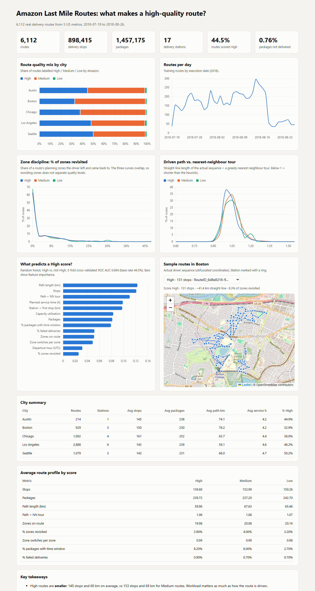

# What makes a high-quality delivery route?

An analysis of **6,112 real Amazon delivery routes** from the
[2021 Amazon Last Mile Routing Research Challenge](https://registry.opendata.aws/amazon-last-mile-challenges/)
(Merchán et al., *Transportation Science* 58(1), 2024). Each route was driven in 2018 in Seattle,
Los Angeles, Austin, Chicago or Boston. Amazon labeled each route **High, Medium, or Low** based on
how it was driven.

**Question:** Which features of the stop sequence a driver actually drove separate High-quality routes from the rest?



## Results

The analysis covers 6,112 routes, 898,415 stops and 1,457,175 packages across 17 stations (19 Jul to 26 Aug 2018).

| | High | Medium | Low |
|---|---|---|---|
| Routes | 2,718 | 3,292 | 102 |
| Avg stops | 139.6 | 153.0 | 150.3 |
| Avg straight-line path (km) | 60.0 | 67.6 | 65.5 |
| Path ÷ nearest-neighbour tour | 1.064 | 1.081 | 1.073 |
| % of zones revisited | 3.9% | 4.0% | 3.2% |

1. **High routes are smaller routes.** They have about 13 fewer stops and about 8 km less driving than Medium routes, so workload is as much a part of "quality" as how the route is driven.
2. **High routes are driven slightly closer to a nearest-neighbour tour**, but the gap is small (1.064 vs 1.081).
3. **Zone discipline does not separate the quality levels.** Drivers at every level revisit only about 4% of their zones, which contradicted my initial hypothesis.
4. **Quality varies by city.** 50% of Seattle routes are High, compared with 33% in Boston.
5. A random forest that separates High from not-High reaches a **5-fold cross-validated ROC AUC of 0.69**. Path length, stop count and path ÷ NN are its top features. Route quality is therefore only partly explained by the observable sequence.

## Pipeline

```
data/raw/*.json  ──build_tables.py──▶  data/processed/{routes,stops,packages}.csv
                 ──analyze.py──────▶  data/processed/route_features.csv
                                      dashboard/data.js  ──▶  dashboard/index.html
```

| Step | What it does |
|---|---|
| `scripts/download.sh` | Downloads the training inputs over HTTPS. No AWS CLI is needed. `travel_times.json` (1.8 GB) is skipped. |
| `scripts/build_tables.py` | Flattens the nested JSON into tidy route, stop and package tables. |
| `scripts/analyze.py` | Engineers route features, trains a cross-validated random forest, and exports dashboard data. |
| `dashboard/index.html` | A static dashboard built with Chart.js and Leaflet. Open it in any browser. |

### Engineered features

| Feature | Meaning |
|---|---|
| `zones_revisited_pct` | Share of the route's planning zones that the driver left and came back to later |
| `zone_switches_per_zone` | Number of zone changes along the sequence ÷ number of distinct zones (1.0 means each zone was entered once) |
| `path_vs_nn` | Haversine length of the driven sequence ÷ a greedy nearest-neighbour tour from the station |
| `first_leg_km` | Distance from the station to the first stop |
| `capacity_util` | Total package volume ÷ vehicle capacity |
| `tw_pct`, `failed_pct` | Share of packages with a delivery time window, and share of packages not delivered |

## Run it

Requires Python 3.9+ with `pandas`, `numpy` and `scikit-learn`.

```bash
sh scripts/download.sh          # ~465 MB
python scripts/build_tables.py  # ~1 min
python scripts/analyze.py       # ~2 min
# open dashboard/index.html
```

## Caveats

- Amazon obfuscated and perturbed the coordinates, so distances are straight-line approximations, not road distances.
- The labels are imbalanced: only 102 routes are Low. The model therefore predicts **High vs. not High**.
- Amazon derived its quality labels partly from factors that are not in the data, such as driver experience and customer feedback, so a modest AUC is expected.
- Only the training split is used. The evaluation split contains only High routes, so it cannot be used to compare quality levels.

## Data & license

The data comes from the Amazon Last Mile Routing Research Challenge, published on the Registry of Open Data on AWS
(`s3://amazon-last-mile-challenges/almrrc2021/`). Its use is subject to the dataset's license (CC BY-NC 4.0).
The schema is documented at [MIT-CAVE/rc-cli](https://github.com/MIT-CAVE/rc-cli/blob/main/templates/data_structures.md).
